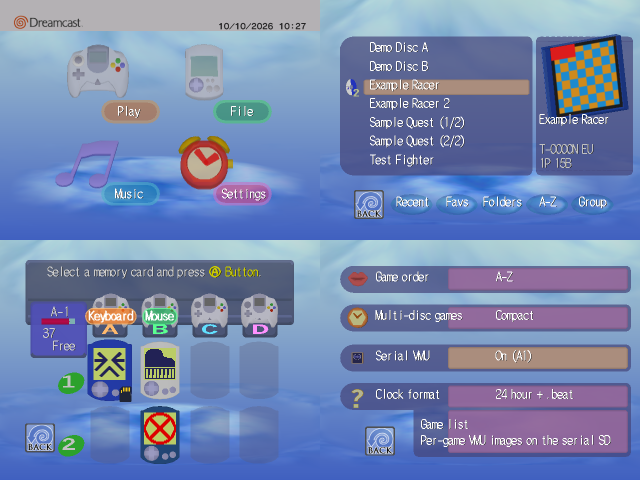
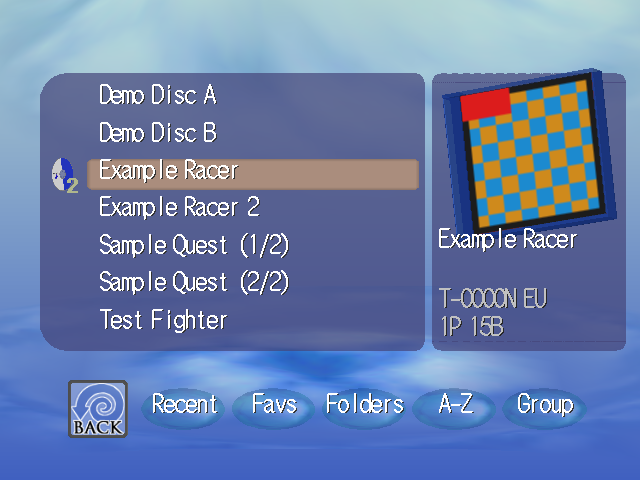
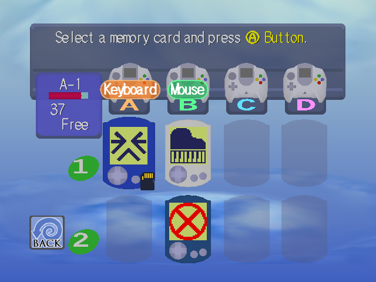
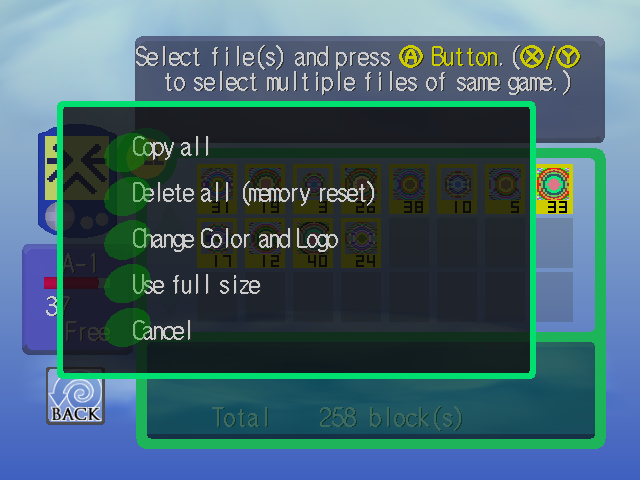
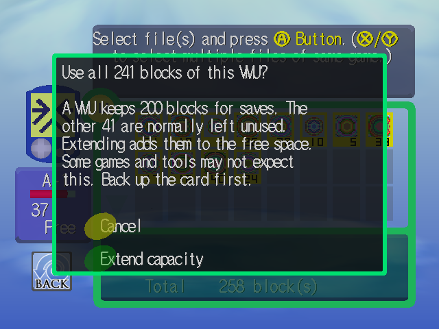
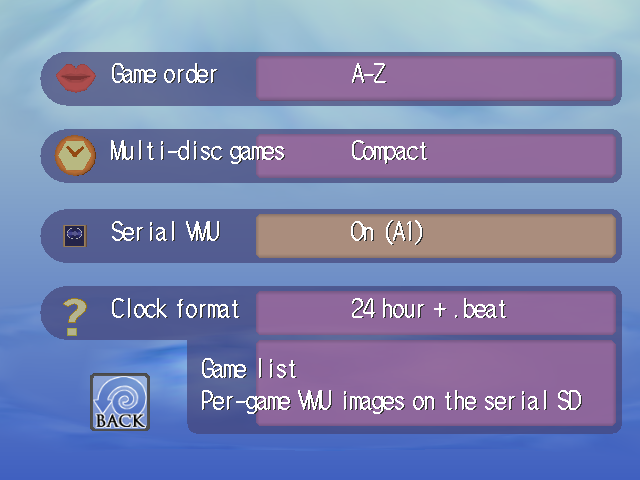

# openMenu, BIOS-style menu edition

A menu for SEGA Dreamcast [GDEMU](https://gdemu.wordpress.com/about/) users that looks and behaves like the console's own BIOS: the same 3D icons, the same font, the same sounds, the same File screen. Nothing of the BIOS is shipped: the menu reads the boot ROM of the console it runs on and builds its screens from it.

It is a fork of **openMenu Virtual Folder Bundle** by Derek Pascarella (ateam), which in turn builds on the openMenu of mrneo240, megavolt85 and sbstnc. The game list, virtual folders, disc sets, per-game VMUs and the card layout all come from that work, and the menu keeps working with the same SD card and the same save files (see [Compatibility](#compatibility-with-the-original-virtual-folder-bundle)). What is new is the look and the screens around it.

The pictures in this file are renders made on a PC with the real menu code and a BIOS dump (`openMenu/tools/screenshots/make_screenshots.sh`), not captures from a console.

---

## Contents

- [What is different](#what-is-different)
- [The screens](#the-screens)
  - [Play](#play)
  - [File](#file)
  - [Music and Internet](#music-and-internet)
  - [Settings](#settings)
- [Controls](#controls)
- [Compatibility with the original Virtual Folder Bundle](#compatibility-with-the-original-virtual-folder-bundle)
- [Installing](#installing)
- [Settings reference](#settings-reference)
- [Upcoming](#upcoming)
- [Status](#status)
- [More documents](#more-documents)
- [Credits](#credits)
- [Legal and licensing](#legal-and-licensing)

---

## What is different

| | openMenu Virtual Folder Bundle | This fork |
|---|---|---|
| Look | Grid, line, scroll and folders views, themes | The BIOS: its icons, models, font, sounds and clouds, read from the console's ROM |
| Game list | Text list with artwork | One BIOS-style box with a spinning GD-ROM disc for the selected game, a 3D jewel case with the front art, and an information panel |
| File screen | None (the BIOS has one) | The BIOS File screen inside the menu: cards, files, copy, delete, memory reset, change icon and colour, full size |
| Controllers | The first controller | Every controller, mouse and keyboard in every port |
| Online | Dreamcast Now! | Dreamcast Now! and DCNET on an Internet screen, with the network shown in the header logo |
| Themes, background music, cheats menu | Yes | Not in this fork (the look is the BIOS's) |

The old interface and its themes are not part of this fork, so their settings are not documented here.

---

## The screens

### Play

- One box of seven lines. The selected game has a lit pill and a 3D GD-ROM disc that spins as in the BIOS's CD player, carrying the game's own disc label when the card has it (the Card Manager stores them in `DISC.DAT`), else the icon art, else the BIOS disc of its region (blue for PAL, red otherwise).
- On the right: the jewel case with the box art (`BOX.DAT`), the game's name, product code, region, players, VMU blocks and disc count.
- Virtual folders from the Card Manager, multi-disc sets (one entry per set, Left and Right pick the disc), PlayStation discs through Bleem! or Bloom, recently played games, remembered last game.
- Five buttons along the bottom, as in the BIOS's CD player: **Recent**, **Favorites**, **Folders**, **Sort** (A-Z, release year, SD card order) and **Group** (more groups are coming).
- **X** opens the game's options (start, disc, emulator, favorite, game information), **Y** opens the case viewer: rotate and zoom the case, read genre, online play, accessories and the description from `META.DAT`.
- Favorites are starred games kept in the menu's own file, so the list works with a VMU, an SD card or both.
- **Serial VMU**: a game's VMU image is restored from the serial SD card before it starts and backed up the next time the menu starts, in the same folders as the original (`OPENMENU/SAVES/<serial>/SLOT1.VMU`).

### File

The BIOS File screen, ported from the ROM with the same objects, positions, messages and behaviour, running inside the menu:

- **Card grid** of the eight memory card sockets A1 to D2 with free blocks, the used-space gauge, the selected card animating and the controllers in their ports.
- **Controller labels**: a pill in the style of the main menu's captions sits on every controller that is not a standard one: Keyboard, Mouse, Lightgun, Fishing, Arcade, Twin, Racing, Maracas, Train, Panther, Dance, Dreameye, Mic, Karaoke, in the colours of the Play, File, Music and Settings pills. The name comes from what the device reports. Pills stay at the bottom of their controller; one that would touch its neighbour moves to the top of its own controller.
- **Serial VMU mark**: the VMU that the Serial VMU uses carries a small SD card at the lower right of its card. Press **X** on a VMU in the grid to open a small menu, **Set as Serial VMU** or **Serial VMU Off**.
- **File window**: 24 tiles a page with the files' animated icons and block counts, copy-protected files in red, VMU games in green, file information, select all (the card) and select every file of the same game (X or Y).
- **Copy and delete** with the BIOS's own questions and messages, and a copy box with a progress bar.

A on the card opens its menu:

| Entry | What it does |
|---|---|
| Copy all | Copies every file that can be copied to another card |
| Delete all (memory reset) | The BIOS's format: erases everything and rebuilds the card, with the icon and colour pickers |
| Change Color and Logo | The same icon and colour pickers, but nothing is erased |
| Use full size | A warning and **Cancel** / **Extend capacity**. A VMU keeps 200 blocks for saves and leaves 41 unused; this adds them to the free space (241 blocks) |
| Cancel | Back to the files |

Copying, deleting, resetting and extending write to real memory cards: back up a card first and try them on a spare one.

### Music and Internet

- **Music** is the BIOS's CD player (the disc in the drive, its buttons and digits).
- With **Settings > Online features** on, the icon becomes **Internet**: players online, the games being played (A starts a game that is on the card), upcoming events and the connection settings, through Dreamcast Now! or DCNET. News needs the DreamPi companion and is not there yet. The header logo follows the network, with a turning swirl while connecting.
- Connection through a modem, a broadband adapter, a LAN adapter or the serial cable to a DreamPi.

### Settings

The BIOS Settings screen: four rows with an icon, a pill and a text line, and a help box under them. Rows with more than two choices open a popup. The BIOS's own settings (language, date and time, sound, auto start, memory card clock) come first and are written to the console's flash exactly as the BIOS writes them. The other rows are listed in the [settings reference](#settings-reference).

---

## Controls

Every controller, mouse and keyboard in any port steers the menu.

| | Controller | Mouse | Keyboard |
|---|---|---|---|
| Move | D-pad (held keys repeat) | Move over a row, tile or button to select it; wheel moves, or turns the pages | Arrows, Page Up and Page Down |
| Choose | A or Start | Left click on something | Enter |
| Back | B | Right click | Escape or Backspace |
| Game options, the VMU menu | X | | Tab |
| Case viewer, select the same game | Y | | Space |
| Jump in the list | | | Type a letter or digit |

A click on nothing does nothing.

---

## Compatibility with the original Virtual Folder Bundle

This menu is meant to be swapped with the original on the same card without damaging anything.

- **`OPENMENU.SYS` and the SD copy `OPENMENU/OPENMENU.CFG`** have the same version and the same variables as the original's, in the same order, and this menu only writes values the original knows. Nothing is added to them.
- **Things only this menu has** are stored beside them: the favorites and the Swatch .beat clock flag in `OPENMENU.FAV` on a memory card and `/sd/OPENMENU/FAVORITES.DAT` on the SD card. The original does not read these files.
- **Serial VMU** uses the original's layout (`OPENMENU/SAVES/<serial>/SLOT1.VMU`, `TITLE.TXT`, `OPENMENU/LASTDISC.TXT`), so both menus restore and back up the same images. **Serial VMU Slots** (five images per game) are not supported yet: with it on, a game starts without Serial VMU and no file is touched.
- The **Card Manager** needs no change: the card it writes (`OPENMENU.INI`, `ICON.DAT`, `BOX.DAT`, `META.DAT`, `DISC.DAT`, folders) is what this menu reads. The only additions are three small logo pictures (`NOWO.PVR`, `NOWB.PVR`, `CNET.PVR`) in its `tools/openMenu/menu_data` folder, which the original menu ignores.
- The BIOS settings rows and the Clock extender write the console's flash, as the BIOS and the original do.

A save made by an earlier build of this menu with a Swatch .beat clock (a value the original resets) is converted at the first start.

---

## Installing

1. Build the card with GD MENU Card Manager as usual (this repository includes the original's modified Card Manager; its own README describes it).
2. Replace `1ST_READ.BIN` in the Card Manager's `tools/openMenu/menu_data` folder with this menu's build, and keep a copy of the original to go back. `STOCK_CARD_MANAGER.md` has the details, the optional `LOGO.PVR`, and the `[BIOSMENU]` section of `DEFAULTS.INI` that sets the menu's settings from the card.
3. Save the card as usual. Updating openMenu from inside the Card Manager puts the original's `1ST_READ.BIN` back.

Building the menu needs Docker and takes the steps in `openMenu/BUILD_INSTRUCTIONS.md`. The menu itself needs no files from you: it reads the console's BIOS at start. Without a usable BIOS it falls back to a plain text list.

---

## Settings reference

| Group | Row | Choices |
|---|---|---|
| BIOS | Language, Date and time, Sound, Auto start, Memory card clock | as in the BIOS |
| BIOS | Clock extender | Off, On: keeps the date in flash at each start |
| Game list | Game order | A-Z, SD card order, Release year |
| Game list | Multi-disc games | Show all discs, Compact |
| Game list | Disc sets from | Anywhere, Same folder only |
| Game list | Recently played | Off, last 10 to 50 |
| Game list | Remember last game | Off, On |
| Game list | Serial VMU | Off, or On with the port and socket (also set from the File screen) |
| Display | Clock format | 12 hour, 24 hour, Date only, each also with Swatch .beat |
| Display | Aspect ratio | 4:3, 16:9 (squeezes everything but the background) |
| Online | Online features, Player list refresh, VMU online status, Online time sync | as in the original's Dreamcast Now! settings |
| System | VMU time sync, VM2 game ID | Off, On / Send to all, Send to first, Off |
| Starting games | Boot animation, Exit to BIOS | Full, License only, Animation only, Fast / Standard, Alternate, Alternate 3D |
| Other | Card defaults, Performance test, About | |

---

## Upcoming

- **Group** on the Play screen: genre, developer, publisher, release year (needs more data from the Card Manager), local and online multiplayer, modem, broadband, serial.
- **Versions of a game** grouped together, a version picker in the game options.
- **Game options**: per-game network (Dreamcast Now! or DCNET), cheats.
- **Case viewer** with a scrolling description, flipping to the back, optionally opening the case.
- **File screen**: Serial VMU on and off moved here from Settings, back up now and load backup, VMU slot and GameID for VM2, VMU Pro, USB4Maple and Pico2Maple, battery level, more controller modes, Serial VMU saves.
- **Internet**: the online game catalogue with connection methods, news, notifications for starred players and games, the ISP settings editor, Ethernet and Wi-Fi settings through a DreamPi.
- **Serial VMU Slots** (five images per game) for compatibility with the original.
- **Performance**: 60 frames a second everywhere.

---

## Status

The menu is under development. The screens are built against the console's ROM and checked on a PC with the real engine code; the maintainer tests on a console. Not yet run on a console: copying, deleting, resetting and extending real cards, the Serial VMU restore and backup, favorites, the Internet pages, and the input from every port. The test lists are in `openMenu/TEST_PLAN.md` and `openMenu/TEST_CHECKLIST.md`.

---

## More documents

- `openMenu/NEWMENU.md`: how each screen is built, with the numbers
- `openMenu/PROJECT_BRIEF.md` and `openMenu/ROADMAP.md`: the plan and how far the code is
- `openMenu/STOCK_CARD_MANAGER.md`: using this menu with the stock Card Manager
- `openMenu/BUILD_INSTRUCTIONS.md`: building
- `openMenu/tools/screenshots/`: the pictures of this file

For the Card Manager's own usage (adding games, virtual folders, artwork, disc types, sorting), see its README in `GD MENU Card Manager/` and the [original project](https://github.com/DerekPascarella/openMenu-Virtual-Folder-Bundle).

---

## Credits

This fork stands on a lot of work by other people:

- **Derek Pascarella (ateam)**: openMenu Virtual Folder Bundle, which this is a fork of: virtual folders and subfolders, the modified GD MENU Card Manager, Dreamcast Now!, Serial VMU, multi-disc launcher, recently played, remember last game, the settings save file this menu shares, and many more features and fixes
- **mrneo240 (Hayden Kowalchuk)**: the original openMenu
- **megavolt85**: the fork that added new features
- **sbstnc**: the fork that added the Docker development container
- **Sonik**: GD MENU Card Manager
- **The Dreamcast scene**: GDEMU, KallistiOS, the VM2, VMU Pro, USB4Maple and Pico2Maple projects, the DreamPi and Dreamcast Now! / DCNET services, Bleem! and Bloom, and everyone who documented the BIOS and the VMU
- **darc** for [Redump2CDI](https://dreamcast.wiki/Redump2CDI)
- **Testers and idea givers of the original**: NO HXRO, SEGA RPG FAN, Kanji, agarpac, null, Ade, NeoGohan, pipporamone, Tongara, Chris Daioglou, Retro Repair Corner, Farkus, FMRad10, Colin L., PlayerGameSK, Virtua Shenmue, Nachosonic, Patrick Graham, onlycodered, Hass, RazorX

---

## Legal and licensing

### openMenu
This project includes a modified version of openMenu, which is:

**Copyright © 2021, Hayden Kowalchuk**

Licensed under the Modified BSD License (3-Clause BSD License)

The original openMenu project was created by Hayden Kowalchuk (mrneo240), with subsequent forks and contributions by megavolt85, sbstnc and Derek Pascarella (ateam). For the full license text, see `/openMenu/LICENSE.md`.

### The BIOS
No BIOS data is shipped, committed or copied by this project. The menu reads the boot ROM of the console it runs on at run time. The pictures in `images/` show the menu as drawn from a BIOS dump on a PC; the Dreamcast BIOS, its models, its typeface and its sounds are the property of SEGA.

### GD MENU Card Manager
This project includes a modified version of GD MENU Card Manager by Sonik:

**Original work**: Copyright (C) 2021, Sonik

**Original repository**: https://github.com/sonik-br/GDMENUCardManager

Licensed under the GNU General Public License v3.0 (GPL-3.0). The modifications by Derek Pascarella (ateam) are licensed under the same terms. For the full license text, see `/GD MENU Card Manager/LICENSE`.

**Source Code Availability**: Per GPL-3.0 requirements, the complete source code for GD MENU Card Manager is included in this distribution at `/GD MENU Card Manager/src/`.

### Third-Party Components
The Card Manager and the menu include additional third-party components with their own licenses:
- **Aaru Data Preservation Suite (LGPL v2.1)** - Copyright © 2011–2021 Natalia Portillo, provides disc image parsing and CD sector decoding (see `/GD MENU Card Manager/src/GDMENUCardManager.Core/Aaru/`)
- **DiscUtils (MIT)** - Copyright © 2008–2011 Kenneth Bell (see `/GD MENU Card Manager/src/GDMENUCardManager.Core/DiscUtils/DiscUtils-LICENSE.txt`)
- **SevenZipSharp (LGPL v3)** - Copyright © 2009–2010 Markovtsev Vadim, managed .NET wrapper for 7-Zip, used by the Windows version (see `/GD MENU Card Manager/src/GDMENUCardManager/SevenZip/`)
- **7-Zip native library (LGPL v2.1+)** - Copyright © Igor Pavlov, archive extraction, used by the Windows version
- **SharpCompress (MIT)** - Copyright © Adam Hathcock, archive extraction, used by the Linux/macOS version
- **libchdr (BSD 3-Clause)** - native CHD disc image library from the MAME project (see `/GD MENU Card Manager/src/GDMENUCardManager.Core/runtimes/`)
- **gdidrop (BSD 2-Clause)** - Copyright © 2019 Feyris-Tan, code used for Redump GD-ROM CUE/BIN to GDI conversion (see `/GD MENU Card Manager/src/GDMENUCardManager.Core/gdidrop-LICENSE.txt`)
- **Avalonia (MIT)** - cross-platform .NET UI framework
- **MessageBox.Avalonia (MIT)**
- **SixLabors.ImageSharp (Six Labors Split License v1.0)** - free for use in OSI-approved open-source projects
- **ClosedXML (MIT)**
- **ByteSize (MIT)**
- **NLayer (MIT)** - Copyright © Mark Heath and Andrew Ward, MP3 decoding
- **NVorbis (MIT)** - Copyright © Andrew Ward, OGG Vorbis decoding
- **CUETools.Codecs / CUETools.Codecs.FLAKE (LGPL v3)** - FLAC decoding
- **gong-wpf-dragdrop (BSD 2-Clause)** - Windows version only
- Various libraries in `/openMenu/external/` with their respective licenses

All original copyright notices and licenses for these components have been preserved.
